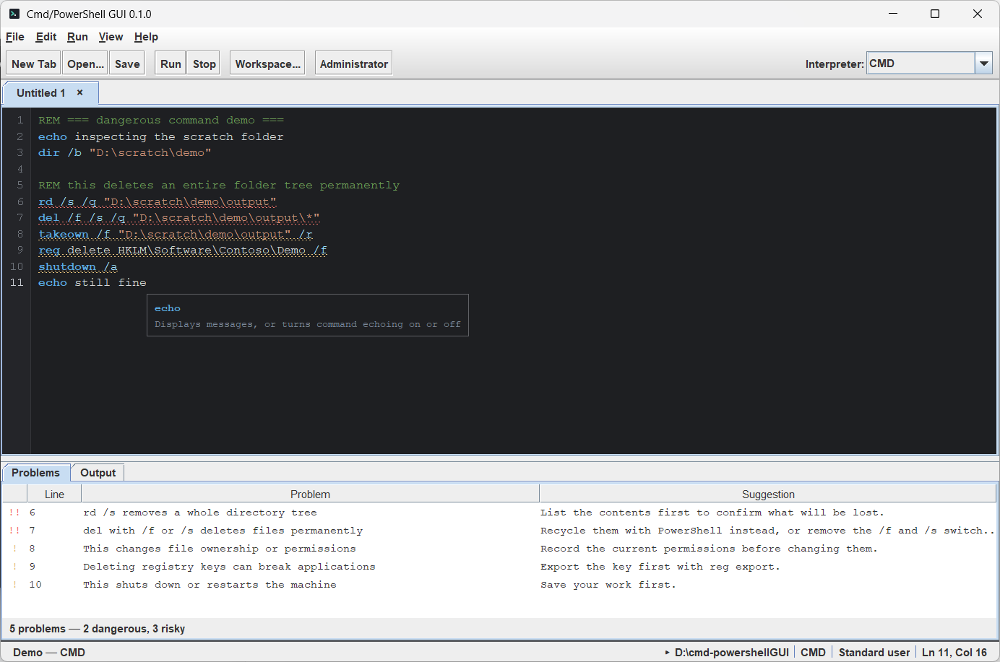
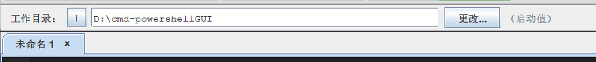

# Cmd/PowerShell GUI

> A Windows graphical front end for `cmd.exe` and `powershell.exe` — type commands
> straight into a terminal, or edit, check and complete command scripts like an IDE.

**English** | [简体中文](README.md)

[](#technology-choices)
[](#technology-choices)
[](#requirements)
[](#build-and-run)
[](LICENSE)



*The screenshots show the Chinese interface; the application is bilingual and
switches language at run time.*

---

## ⚠️ How this project was produced

**All of the code, documentation and assets in this project were generated by AI.**

- Code: written and revised by AI over several rounds; a human set the
  requirements, reported problems and accepted the result.
- Documentation: this `README.md`, its Chinese counterpart and the images under
  `docs/` are AI generated as well.
- Verification: the project ships **20 developer checks** (see [Testing](#testing)).
  19 of them print an explicit pass or fail verdict; the twentieth (`SessionProbe`)
  prints a report from a real interpreter session. Every change has to pass them
  before it is committed, and the output is a real run rather than an opinion.

Please weigh that when judging whether the code suits you, and review it yourself
before using it in production.

---

## Download and install

### Option 1: portable archive (recommended)

Download [`dist/CmdPowerShellGUI-0.1.0-win-x64.zip`](dist/CmdPowerShellGUI-0.1.0-win-x64.zip)
(about 25 MB), unpack it anywhere and run `CmdPowerShellGUI.exe`.

* A trimmed Java runtime is bundled, so **the target machine needs no Java**.
* It writes no registry entries, installs no service and creates no files outside
  its own folder. Deleting the folder uninstalls it completely.
* Windows 10 and 11, 64 bit.

### Option 2: installer (needs WiX)

```powershell
.\package.ps1 -Clean -Installer
```

`jpackage` needs the **WiX Toolset 3.0 or newer** on the machine to build an msi.
When it is missing the script says so and skips the step; the portable archive is
already a complete distribution. WiX: <https://github.com/wixtoolset/wix3/releases>

### Option 3: run from source

See [Build and run](#build-and-run) below.

---

## What problem this solves

Using `cmd` or PowerShell day to day runs into the same annoyances:

* One line at a time; changing the previous command means holding an arrow key;
* A long or complicated command that goes wrong has to be retyped from scratch;
* `del /f /s /q` and `Remove-Item -Recurse -Force` are **dangerous commands with
  no second confirmation**;
* Saving a set of useful commands means a `.bat` file, with no editor support;
* On a Chinese system the console code page and script encoding disagree and the
  output turns into mojibake.

This project merges the terminal and the code editor into one window: you work in
a tabbed editing area, write commands as code (multiple lines, comments, syntax
highlighting, completion, diagnostics), and press **Run** to hand them to a real
`cmd.exe` or `powershell.exe`, with the output appearing live in the console below.

---

## Features

| Feature | Description |
| --- | --- |
| **Two interpreters** | Calls `cmd.exe` and `powershell.exe` natively, not a simulation; the tool bar selector follows the active tab |
| **Persistent session** | One process per tab, so `cd`, `set` and PowerShell variables survive between runs |
| **Two console modes** | **Blocks**: a rule separates each run and stopping discards the interpreter. **Terminal**: output runs on continuously, one interpreter is kept and stopping only gives up the current run — a new interpreter is started only when you ask for one |
| **Interactive commands** | Commands that ask a question (`time`, `set /p`, `pause`, `choice`) can be answered: the session notices it is waiting and sends the next line typed below straight to it |
| **Multiple tabs** | Each tab has its own session; a `*` in the title means unsaved changes; middle click or × closes |
| **Single or batch execution** | `Ctrl+Enter` runs the selection or the whole script, `Ctrl+Shift+Enter` runs all of it, `Ctrl+L` runs only the caret's line |
| **Single-line mode** | A tool bar toggle: each run executes the caret's line and moves down one, washing successful lines green and failures red across the whole row |
| **Real exit codes** | Every run reports the exit code the interpreter returned, in red when it failed |
| **Syntax highlighting** | Commands, keywords, switches, parameters, variables, strings, numbers, operators, labels and comments each get their own colour rather than one shade |
| **IntelliSense** | 96 cmd commands with their switches, 163 PowerShell cmdlets and keywords, environment and automatic variables; a single match appears inline, several open a list, `Ctrl+Space` asks on demand |
| **Inline suggestion and Tab** | Greyed text after the caret, **matched without regard to case**, and always the same entry the list has highlighted, so Tab inserts exactly what is on screen |
| **Path completion** | Relative and absolute paths both work: `build\cp` lists the workspace, `cd C:\Win` completes to `C:\Windows\` |
| **Parameter hints** | With the caret in a command's arguments the status bar shows what the command does and which switches it takes |
| **Static checks** | 40 rules run as you type; the problem list jumps to the line on a double click |
| **Dangerous command confirmation** | Deleting, formatting, shutting down, changing permissions and bypassing policy are listed in a dialog that defaults to Cancel |
| **Undo and redo** | `Ctrl+Z` and `Ctrl+Y`, with ↶ ↷ buttons on the tool bar; colour changes from the highlighter never pollute the undo stack |
| **Workspace switching** | Pick a directory graphically, equivalent to `cd /d`, applied to every open session and to the file tree |
| **File explorer** | A tree on the left that expands on demand; double click a file to open it or a folder to expand it; right click to create, delete or use as the working directory |
| **Syntax reference** | `F1` opens a searchable list of commands and their parameters, runs `/?` or `Get-Help` in the console on request, and links the official documentation in English and Chinese |
| **Administrator mode** | Opens a second, elevated window in one click — the portable image included; the launch command is restored, quoting is handled, and a failure shows the reason Windows gave |
| **File handling** | New, open and save `.cmd`, `.bat` and `.ps1`, with a prompt when closing unsaved work |
| **Chinese and English** | The interface follows the system language and can be switched at run time from View → Language; command descriptions are bilingual too |
| **Dark and light themes** | Dark by default, with light and follow-the-system options under View → Theme, and depth on the buttons |
| **Font choice** | View → Font sets the family, style and size for the editor and the console separately, with a live preview and a restore-defaults button; fonts that cannot draw Chinese are marked |
| **Spelling check** | An unknown command such as `exyzxo` gets a squiggle and a problem entry |
| **Desktop application** | Plain JDK, packageable with `jpackage` into a portable `.exe` that needs no Java on the target machine |



---

## Requirements

* Windows 10 or 11
* **JDK 17 or newer** (developed and verified on JDK 27)
* No Maven or Gradle, and no third-party dependency to download

---

## Build and run

```powershell
.\build.ps1 -Clean        # compile and package -> build\cpgui.jar
.\build.ps1 -Run          # compile, then start
```

From `cmd.exe`:

```bat
build.bat
run.bat
run-latest.bat            # pins D:\Java\jdk-27 and prints the jar time and SHA256
```

`run-latest.bat` prints the **JDK path, the jar's build time and size, its SHA256
and the current commit**, which is there to confirm exactly which build is running.

### Packaging

```powershell
.\package.ps1 -Clean -Zip             # application image plus portable archive
.\package.ps1 -Clean -Zip -Installer  # also try an msi (needs WiX)
```

| Artefact | Description |
| --- | --- |
| `dist\CmdPowerShellGUI\CmdPowerShellGUI.exe` | Portable application image (about 74 MB, runtime included) |
| `dist\CmdPowerShellGUI-0.1.0-win-x64.zip` | The archive published to users (about 25 MB) |
| `dist\*.msi` | Installer, produced only when WiX is present |

Two things to know:

* **jpackage fails when the target directory already exists, so `-Clean` is required.**
* **Close any running copy first**, otherwise `build\cpgui.jar` is locked and the
  packaging step fails.

### Diagnosing administrator mode

The portable image has no console, so a failure leaves no message behind. Have it
write a report of this start instead:

```powershell
dist\CmdPowerShellGUI\CmdPowerShellGUI.exe --elevation-report report.txt
type report.txt
```

`relaunch executable` is the program the **Administrator** action will start, and
`relaunch executable exists` must be `true`. In the portable image
`java.home/java.exe` is **always `false`**: jpackage builds its runtime with
`jlink --strip-native-commands`, so there is no `java.exe` in it — only the
launcher the image ships. Earlier builds tried to start that missing `java.exe`,
which is exactly why administrator mode would not open from the archive.

---

## Shortcuts

| Shortcut | Action |
| --- | --- |
| `Ctrl+Enter` | Run the selection, or the whole script when nothing is selected |
| `Ctrl+Shift+Enter` | Run the whole script, ignoring the selection |
| `Ctrl+L` | Run only the caret's line |
| `Ctrl+Space` | Ask for completion |
| `Tab` | Accept a completion or the inline suggestion |
| `↑` `↓` | Walk the completion list; with it closed, walk the console history |
| `Ctrl+Z` / `Ctrl+Y` | Undo / redo |
| `Ctrl+N` | New tab |
| `Ctrl+O` / `Ctrl+S` | Open / save |
| `Ctrl+K` | Choose the working directory |
| `Ctrl+Shift+E` | Show or hide the file explorer |
| `F1` | Open the syntax reference |
| `Ctrl+=` / `Ctrl+-` | Grow or shrink the editor font |

---

## Project layout

```
src/main/java/com/dogepopcat/cpgui/
├── Main.java                    entry point: look and feel, --workspace, --elevation-report
├── AppInfo.java                 name and version
├── analysis/                    static analysis
│   ├── ScriptParser.java        splits a script into lines, spots comments, keeps exact offsets
│   ├── ShellLexer.java          token classification (command/keyword/switch/parameter/variable/string/number/operator/comment/label)
│   ├── DangerAnalyzer.java      40 dangerous and suspicious rules
│   └── CommandResolver.java     does the command exist (catalogue + aliases + PATH×PATHEXT)
├── completion/                  completion
│   ├── CommandCatalog.java      cmd commands and switches, PowerShell cmdlets and parameters, bilingual
│   ├── CompletionProvider.java  context, candidate filtering and the range to replace
│   ├── PathCompleter.java       relative and absolute path completion
│   └── ParameterHint.java       parameter signature hints
├── shell/                       talking to the interpreter processes
│   ├── ShellSession.java        persistent process, end-of-run marker protocol, interactive input, submission queue
│   ├── SessionRegistry.java     one session per tab
│   ├── ShellKind.java           display names and executables for cmd and PowerShell
│   ├── ConsoleCharset.java      reads chcp and maps it to a Java charset
│   └── ConsolePalette.java      the sixteen colours of the color command
├── io/
│   ├── ScriptFile.java          reads and writes .cmd/.bat/.ps1, handling the BOM and unrepresentable characters
│   └── WorkspacePolicy.java     refuses system directories as a workspace
├── i18n/                        Chinese and English (a missing Msg translation is a compile error)
└── ui/                          the Swing interface (below)
```

Key classes in the interface package: `MainFrame` (window and actions),
`EditorTabs`/`EditorTab` (tabs and text area),
`CompletionController`/`CompletionPopup`/`GhostTextPane` (completion),
`SyntaxHighlighter`/`LineNumberView`/`DiagnosticsOverlay`/`SquigglePainter`
(display), `ConsolePane` (console and input line), `FileExplorer` (file tree),
`ProblemsPanel` (problem list), `Theme`/`FontSupport`/`FontChooserDialog`
(colours and fonts), `HelpWindow` (syntax reference) and `ConsoleMode` (blocks
or terminal).

---

## Testing

The project ships 21 developer checks under `tools/dev/dev/`, which are not part
of the distribution; 20 print `RESULT: PASS/FAIL` and `SessionProbe` prints a
session report. Compile and run them with:

```powershell
$javac = "D:\Java\jdk-27\bin\javac.exe"
& $javac "-J-Duser.language=en" -encoding UTF-8 -cp "build\classes" -d "build\tools" `
    (Get-ChildItem -Recurse "tools\dev" -Filter *.java | Select-Object -ExpandProperty FullName)

# one probe, for example
& "D:\Java\jdk-27\bin\java.exe" -cp "build\classes;build\tools" dev.AcceptanceProbe
```

| Probe | What it covers |
| --- | --- |
| `AcceptanceProbe` | **The sweep**: 25 kinds of cmd command and 14 kinds of PowerShell command (built-ins, switches, variables, `if/else`, `for`, `call`, `goto`, `type`, `findstr`, `more`, `sort`, `copy`, `ren`, `del`, `mkdir`, `attrib`, `whoami`, escapes, pipelines, expressions, exceptions) plus every feature surface |
| `CompletionProbe` / `CompletionGuiProbe` | Candidates, the inline suggestion, accepting with Tab, list navigation |
| `GhostProbe` | Case-insensitive matching, and the inline text agreeing with the highlighted row |
| `ConsoleProbe` | Single line input, echoing, history, the block rule |
| `HistoryProbe` | Walking the history, including commands run from the editor, and keeping a draft |
| `InteractiveProbe` | `set /p` answered end to end |
| `TerminalModeProbe` | Terminal mode keeping its session across a stop, blocks mode discarding it, restarting a session |
| `SingleLineProbe` | Running one line at a time and colouring the result |
| `UndoProbe` | Undo and redo staying clean of highlighter edits |
| `DangerProbe` / `LintProbe` | The danger rules and the static checks |
| `ParserProbe` / `FileProbe` | Script parsing and file encoding |
| `WorkspaceProbe` / `AdminProbe` | The workspace policy; the elevation path (command restoration, the portable-launcher fallback, quoting, the `Start-Process` channel) |
| `StyleAuditProbe` | Palette coverage: after switching themes it checks every component, text run and highlight for colours left over from the other palette |
| `FontProbe` / `ThemeProbe` | Font availability and the three palettes with live switching |
| `FixProbe` | Regressions of defects that were fixed |
| `SessionProbe` | A real interpreter session (charset, unfinished runs) |

Conventions:

* A probe that opens a window must call `System.exit`, or it will not end.
* A probe asserting on text pins the language with `Messages.setLanguage` first.
* Probes only work inside scratch directories such as `D:\cpgui-*`; they never
  touch your own files.
* **A probe comparing the interface must call `Main.applyLookAndFeel()` first.**
  The application runs the Windows look and feel while a plain `new MainFrame()`
  gets the cross-platform one, and the two draw differently. Skipping this made
  several rounds of verification meaningless because they ran in an environment
  the user never sees.

---

## Implementation notes

* **The end-of-run marker.** Every submission appends a numbered `echo` as a
  marker, and the run is only finished when it is seen, which is how the real
  exit code is obtained. Internal queries such as reading the working directory
  use the same channel but do not raise the finished callback, or a query made
  from that callback would recurse for ever.
* **An interactive command must not have the marker sent with it.** It reads its
  answer from the same input stream, so the marker would be read as the answer:
  that is why `time` reported that it could not accept the input time. A command
  recognised as asking a question is sent without the marker, and a fresh one is
  sent afterwards to close the run.
* **Submissions have to be queued.** Reading the working directory occupies the
  interpreter too, and refusing a run that landed in that window silently lost
  it. The session queues submissions and runs them in order.
* **A reused session needs its listener replaced.** A session is reused across
  runs, and one that held on to the listener it was created with sent every later
  callback to the first run's receiver.
* **The look and feel decides how things are drawn.** The Windows look and feel
  paints the file chooser's labels, buttons and shortcut side bar straight from
  the system theme, ignoring the colours set on them. The chooser therefore keeps
  the system colours, which are readable in both palettes, and is shown in a
  dialog the application creates itself rather than the one the look and feel
  builds.
* **A font has to be able to draw the current language.** A physical font such as
  Consolas carries no Chinese fallback, and making it the default turned every
  Chinese character into a box. The default family is required to cover both, which
  on a Chinese Windows is New SimSun.
* **Refreshing the look and feel clears the key bindings.** `updateComponentTreeUI`
  replaces every component's input and action map, so it only runs on a real theme
  change, and the completion and console keys are reinstalled afterwards.

---

## Known limitations

* The file chooser stays a **light system dialog** in the dark theme. Its text is
  drawn by the system and cannot be recoloured, and forcing it dark produced black
  on black, so it is kept readable instead.
* Interactive commands are only guaranteed correct for a **single question**
  (`time`, `set /p`, `pause`, `choice`). For a command that asks twice, the
  closing marker may be read as the second answer.
* The console is a **single continuous stream**; there are no split panes.
* Windows only. `cmd.exe` and `powershell.exe` are hard dependencies.
* Administrator mode does not verify the UAC prompt itself (no automation can click
  Yes); everything else — command restoration, the portable-launcher fallback,
  quoting, the `Start-Process` channel and the workspace handed over — is covered by
  `AdminProbe` and `--elevation-report`.

---

## Technology choices

* **Java and Swing**: the requirement was a desktop application, not JavaScript.
  The standard library provides `ProcessBuilder`, Swing and `jpackage`, which
  makes **zero third-party dependencies** possible, and one packaging step
  produces something that runs on a machine with no Java installed.
* **No build tool**: `javac` and `jar` are enough at this size. `build.ps1` is
  about 120 lines, which avoids pulling the Maven or Gradle ecosystem in to
  compile fewer than fifty source files.
* **The theme lives in the `UIManager` defaults**: both palettes are written into
  the look and feel defaults, backed by the palette constants. One trap is worth
  remembering: those defaults must be wrapped as UI resources
  (`ColorUIResource`, `FontUIResource`). Swing only replaces a property whose
  current value *is* a UI resource; a plain value counts as one the application
  set and is never updated again — which is how the dark palette once stayed on
  screen in the light theme. `StyleAuditProbe` switches the palette twice and
  then checks every component, text run and highlight for colours that did not
  follow.

---

## License

[MIT](LICENSE)
